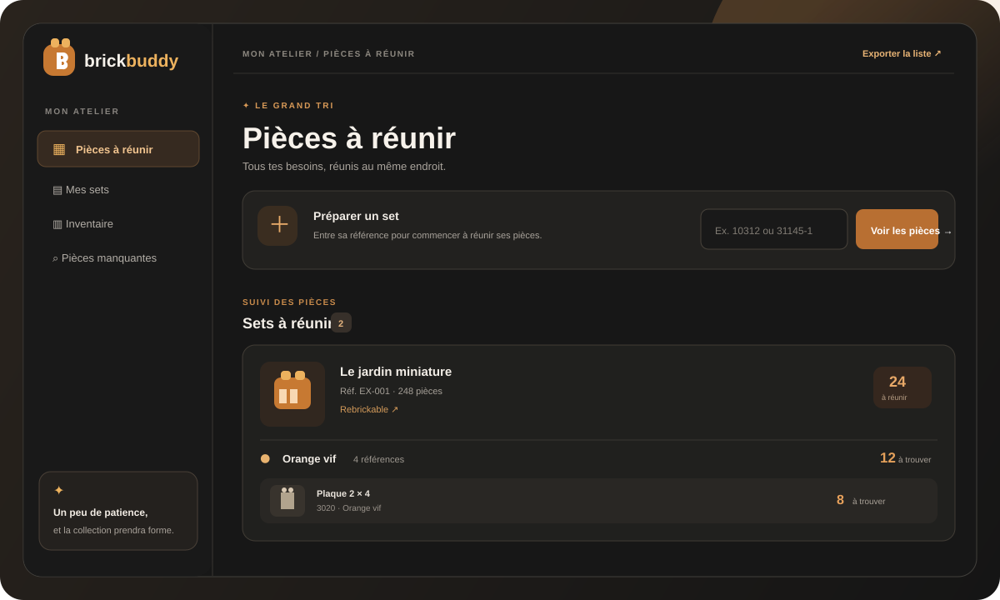

<div align="center">

# 🧱 Brick Buddy

### Ta collection LEGO, enfin bien rangée.

**Retrouve les pièces manquantes, suis chaque exemplaire et garde ton inventaire à jour — sans perdre le fil de ta collection.**

[](https://www.python.org/)
[](https://flask.palletsprojects.com/)
[](https://www.sqlite.org/)
[](https://www.docker.com/)
[](https://github.com/Gazz-yniere/LegoBuddy/actions/workflows/tests.yml)
[](.github/workflows/docker-publish.yml)

<br>



<br>

[Découvrir les fonctionnalités](#-un-atelier-pensé-pour-ta-collection) ·
[Installer avec Docker](#-démarrage-avec-docker) ·
[Lancer en local](#-lancer-en-local)

</div>

## ✨ Un atelier pensé pour ta collection

Brick Buddy est une petite application web privée pour organiser les sets que tu possèdes, ceux que tu veux compléter et toutes les pièces entre les deux. L’interface est en français, les données restent dans ta base SQLite, et Docker permet de la lancer facilement sur ton ordinateur ou ton serveur.

| 🧩 Pièces à réunir | 🏰 Mes sets | 📦 Inventaire | 🔎 Pièces manquantes |
|---|---|---|---|
| Regroupe les besoins par pièce et par couleur. | Suis chaque exemplaire sans mélanger son état avec les autres. | Compte les pièces trouvées dans tes sets possédés. | Ajuste les quantités et prépare une liste d’achat. |

### Tout ce qu’il faut pour garder le fil

- **Un suivi indépendant** : posséder un set et chercher ses pièces sont deux choses distinctes.
- **Plusieurs exemplaires** : chaque copie a ses propres quantités trouvées ou à trouver.
- **Des totaux toujours utiles** : les pièces identiques sont regroupées et les besoins se mettent à jour au fil du tri.
- **Une collection facile à parcourir** : recherche, filtres par couleur, sections repliables et images mises en cache.
- **Des infos de sets enrichies** : année, thème, image et lien Rebrickable lorsqu’une clé API est configurée.
- **Des exports pratiques** : XML pour BrickLink et CSV pour BrickOwl.
- **Un espace privé** : mot de passe partagé, protection CSRF et limitation des tentatives de connexion.
- **Tes données chez toi** : SQLite et cache d’images sont conservés dans le dossier `data/`.

> Brick Buddy est un projet de collection non officiel, sans affiliation ni approbation de LEGO® ou du groupe LEGO.

## 🚀 Démarrage avec Docker

### 1. Préparer la configuration

Dans le dossier du projet, crée ton fichier de configuration local :

```powershell
Copy-Item .env.example .env
```

Génère une clé de session aléatoire :

```powershell
py -c "import secrets; print(secrets.token_urlsafe(48))"
```

Ouvre `.env` et remplace les valeurs d’exemple :

```dotenv
SECRET_KEY=colle-ici-la-cle-aleatoire-generee
APP_PASSWORD=choisis-une-phrase-secrete-de-12-caracteres-minimum
```

Choisis un mot de passe d’au moins 12 caractères. Ne partage pas le fichier `.env` : il contient tes secrets et est ignoré par Git.

### 2. Démarrer l’application

```powershell
docker compose up --build -d
```

Ouvre [http://localhost:8000](http://localhost:8000), puis connecte-toi avec le mot de passe configuré. L’application crée la base et le cache dans `data/`, monté depuis le projet pour que tes données survivent aux mises à jour et aux redémarrages.

Pour arrêter l’application sans supprimer tes données :

```powershell
docker compose down
```

Le point de contrôle [http://localhost:8000/health](http://localhost:8000/health) indique si l’application et sa base SQLite sont accessibles.

### Variables d’environnement

| Variable | Requise | Utilisation |
|---|---:|---|
| `SECRET_KEY` | Oui | Clé aléatoire d’au moins 32 caractères pour signer les sessions. |
| `APP_PASSWORD` | Oui | Mot de passe partagé d’au moins 12 caractères. |
| `PORT` | Non | Port exposé sur l’hôte ; `8000` par défaut. |
| `SESSION_COOKIE_SECURE` | Non | À passer à `true` uniquement lorsque le site est servi en HTTPS. |
| `REBRICKABLE_API_KEY` | Non | Importe automatiquement les pièces et métadonnées depuis Rebrickable. |

Sans clé Rebrickable, tu peux ajouter un set puis saisir ses pièces manuellement. Pour activer l’import automatique, renseigne `REBRICKABLE_API_KEY` dans `.env` et recrée le conteneur :

```powershell
docker compose up -d --force-recreate
```

## 💻 Lancer en local

```powershell
Copy-Item .env.example .env
py -m venv .venv
.\.venv\Scripts\Activate.ps1
pip install -r requirements.txt
```

Configure `SECRET_KEY` et `APP_PASSWORD` dans `.env` comme indiqué plus haut, puis lance :

```powershell
py app.py
```

L’application sera disponible sur [http://localhost:8000](http://localhost:8000).

## 🐳 Image Docker Hub

Le workflow [`docker-publish.yml`](.github/workflows/docker-publish.yml) construit et publie automatiquement une image multi-architecture (`linux/amd64` et `linux/arm64`) dès qu’une release GitHub est publiée. Il reste également possible de le lancer à la demande depuis l’onglet **Actions**.

Pour activer la publication, configure ces valeurs dans **Settings → Secrets and variables → Actions** du dépôt GitHub :

- Secret `DOCKERHUB_USERNAME` : ton identifiant Docker Hub.
- Secret `DOCKERHUB_TOKEN` : un jeton d’accès Docker Hub (pas le mot de passe du compte).
- Variable `DOCKERHUB_REPOSITORY` : nom du dépôt d’image, par exemple `brick-buddy`.

Pour publier une version, crée une release GitHub avec un tag de version, par exemple `v1.0.0` (dans **Releases → Draft a new release → Publish release**). La publication de la release déclenche le workflow ; un simple push de tag ne le déclenche pas.

```bash
git tag v1.0.0
git push origin v1.0.0
```

Sélectionne ensuite ce tag lors de la création de la release sur GitHub.

L’image reçoit les tags de version et `latest`. Pour l’utiliser, remplace `<utilisateur>` par ton identifiant Docker Hub :

```bash
docker pull <utilisateur>/brick-buddy:latest
```

Le workflow de tests [`tests.yml`](.github/workflows/tests.yml) exécute la suite à chaque push et pull request.

## 🧪 Vérifications locales

```bash
python -m pip install -r requirements.txt pytest
python -m pytest -q
```

## 🔐 Confidentialité et sauvegardes

- `.env` contient les secrets et ne doit jamais être commité.
- `data/` contient ta base SQLite et le cache Rebrickable ; ce dossier est ignoré par Git et monté comme volume Docker.
- Pour sauvegarder ta collection, arrête temporairement le conteneur puis copie `data/` dans un emplacement sûr.
- Le mot de passe est partagé par les personnes ayant accès à l’application ; il n’y a pas de comptes individuels ni de séparation entre collections.
- En cas d’accès depuis Internet, place l’application derrière HTTPS et active `SESSION_COOKIE_SECURE=true`.

## 🗺️ Historique

Les évolutions et corrections sont suivies dans [CHANGELOG.md](CHANGELOG.md).
