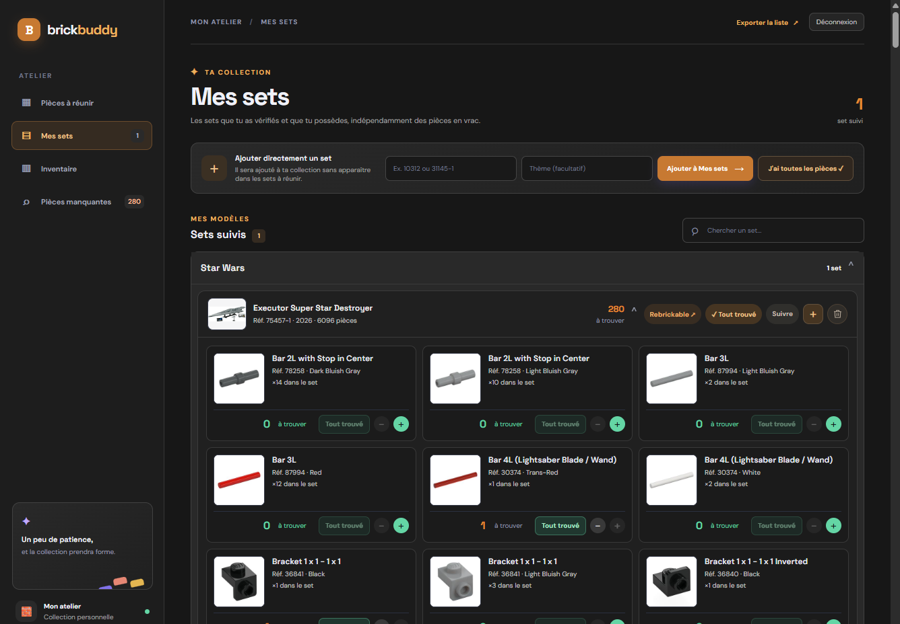
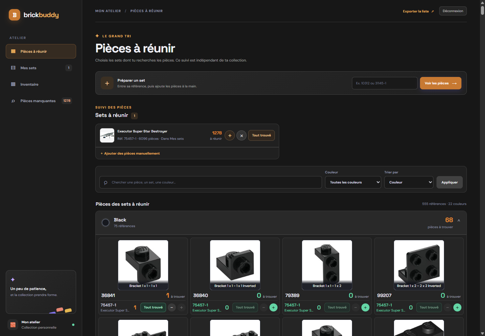
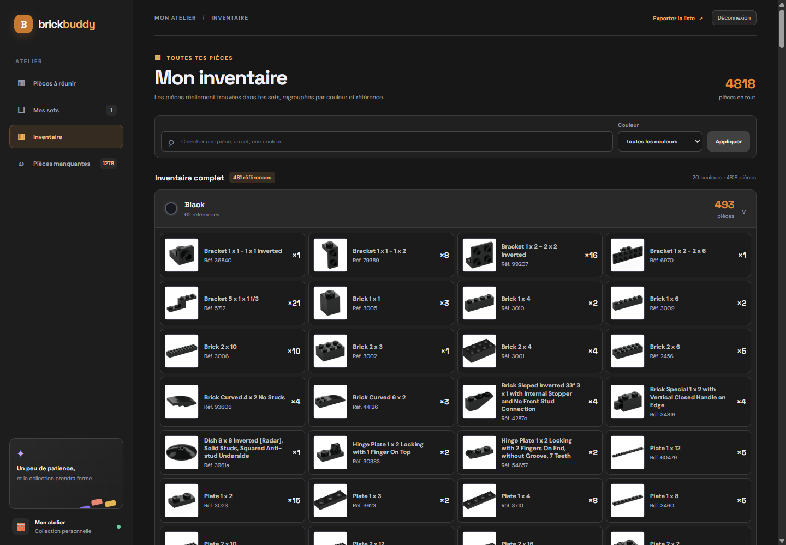
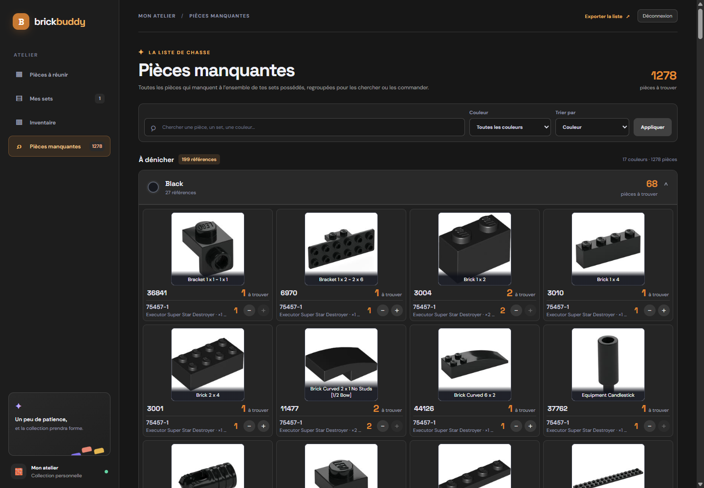

<div align="center">

<h1 align="center"></h1>

### Ta collection LEGO, claire, complète et toujours à portée de main.

**Suis tes sets. Repère chaque pièce manquante. Garde ton inventaire sous contrôle.**

[](https://www.python.org/)
[](https://flask.palletsprojects.com/)
[](https://www.sqlite.org/)
[](https://www.docker.com/)
[](https://github.com/Gazz-yniere/BrickBuddy/actions/workflows/tests.yml)

<br>

<a href="docs/screenshots/mes-sets.png"></a>

<sub>Vraies images du set 75457-1 et de ses pièces · suivi de démonstration</sub>

<br>

[Découvrir l’atelier](#un-atelier-pour-chaque-brique) ·
[Installer en local](#lancer-en-local) ·
[Utiliser l’image Docker](#lancer-avec-limage-docker)

</div>

## Un atelier pour chaque brique

Brick Buddy est une application web en français pour organiser une collection LEGO et retrouver facilement ce qu’il reste à construire ou à compléter. Chaque écran a son rôle, et les quantités se mettent à jour au fil du tri.

| Espace | Ce qu’il permet |
|---|---|
| **Pièces à réunir** | Préparer plusieurs sets et regrouper les besoins par pièce et par couleur. |
| **Mes sets** | Suivre les sets possédés et l’état de chaque exemplaire, pièce par pièce. |
| **Inventaire** | Retrouver les pièces effectivement disponibles dans les sets possédés. |
| **Pièces manquantes** | Voir les pièces qui restent à trouver et ajuster les quantités. |

### Pensé pour les collections qui évoluent

- **Posséder un set ou rechercher ses pièces, c’est distinct** : les deux suivis sont indépendants.
- **Chaque exemplaire a son propre état** : un set complet et une copie incomplète restent faciles à distinguer.
- **Les références identiques sont regroupées** pour voir rapidement les quantités à trouver ou déjà disponibles.
- **Recherche, filtres couleur et sections repliables** facilitent la navigation dans les grandes collections.
- **Les sets peuvent être enrichis avec Rebrickable** : image, année, thème et inventaire des pièces.
- **Les listes s’exportent** en XML BrickLink ou en CSV BrickOwl.
- **La connexion est protégée** par un mot de passe partagé, une protection CSRF et une limitation des tentatives.
- **Les données restent sous ton contrôle** : SQLite et le cache d’images sont conservés dans `data/`.

## L’atelier en images

Les captures présentent le véritable set **[75457-1 · Executor Super Star Destroyer](https://rebrickable.com/sets/75457-1/)**. La couverture et les images des briques proviennent de Rebrickable ; les quantités trouvées ou manquantes sont simulées dans une base de démonstration isolée.

<table>
<tr>
<td width="50%" valign="top">
<a href="docs/screenshots/pieces-a-reunir.png"></a>
<p align="center"><strong>Pièces à réunir</strong><br><sub>Les besoins du set, organisés par couleur et référence.</sub></p>
</td>
<td width="50%" valign="top">
<a href="docs/screenshots/mes-sets.png"></a>
<p align="center"><strong>Mes sets</strong><br><sub>La fiche dépliée et les images réelles des pièces du set.</sub></p>
</td>
</tr>
<tr>
<td width="50%" valign="top">
<a href="docs/screenshots/inventaire.png"></a>
<p align="center"><strong>Inventaire</strong><br><sub>Les pièces disponibles regroupées par couleur.</sub></p>
</td>
<td width="50%" valign="top">
<a href="docs/screenshots/pieces-manquantes.png"></a>
<p align="center"><strong>Pièces manquantes</strong><br><sub>Les quantités à retrouver, avec leurs briques et références.</sub></p>
</td>
</tr>
</table>

> Brick Buddy est un projet de collection non officiel, sans affiliation ni approbation de LEGO® ou du groupe LEGO.

## Configuration commune

Dans le dossier du projet, crée le fichier local `.env` à partir du modèle :

```powershell
Copy-Item .env.example .env
```

Génère une clé de session :

```powershell
py -c "import secrets; print(secrets.token_urlsafe(48))"
```

Dans `.env`, remplace les valeurs d’exemple :

```dotenv
SECRET_KEY=colle-ici-la-cle-aleatoire-generee
APP_PASSWORD=choisis-une-phrase-secrete-de-12-caracteres-minimum
```

`SECRET_KEY` doit être une clé aléatoire d’au moins 32 caractères ; `APP_PASSWORD` doit contenir au moins 12 caractères. Ne partage pas `.env` et ne le commite pas.

| Variable | Rôle |
|---|---|
| `SECRET_KEY` | Signe les sessions de connexion. |
| `APP_PASSWORD` | Mot de passe partagé pour accéder à l’application. |
| `REBRICKABLE_API_KEY` | Facultative ; active l’import des sets et pièces depuis Rebrickable. |
| `PORT` | Port local ; `8000` par défaut. |
| `SESSION_COOKIE_SECURE` | À mettre à `true` uniquement si l’application est servie en HTTPS. |

Sans clé Rebrickable, tu peux ajouter les pièces manuellement.

## Lancer en local

Cette option exécute directement l’application Python, sans conteneur :

```powershell
py -m venv .venv
.\.venv\Scripts\Activate.ps1
pip install -r requirements.txt
py app.py
```

Ouvre ensuite [http://localhost:8000](http://localhost:8000) et connecte-toi avec le mot de passe configuré dans `.env`. La base est créée automatiquement dans `data\legolist.db`.

## Lancer avec l’image Docker

Configure d’abord `.env` comme indiqué plus haut, puis indique dans ce fichier l’identifiant Docker Hub qui héberge l’image :

```dotenv
DOCKERHUB_USERNAME=ton-identifiant-dockerhub
DOCKERHUB_REPOSITORY=brickbuddy
IMAGE_TAG=latest
```

Télécharge l’image et démarre l’application :

```powershell
docker compose pull
docker compose up -d --no-build
```

L’application est ensuite disponible sur [http://localhost:8000](http://localhost:8000). Les données restent dans `data/`, même si le conteneur est arrêté ou remplacé.

Pour mettre à jour l’image, relance les deux commandes `docker compose pull` puis `docker compose up -d --no-build`. Pour arrêter l’application sans supprimer les données :

```powershell
docker compose down
```

Le point de contrôle [http://localhost:8000/health](http://localhost:8000/health) indique si l’application et sa base sont accessibles.

## Données et sauvegardes

- `.env` contient les secrets locaux ; il est ignoré par Git.
- `data/` contient la base SQLite et le cache d’images ; il est conservé comme volume Docker.
- Pour sauvegarder la collection, copie le dossier `data/` vers un emplacement sûr.
- L’accès utilise un mot de passe partagé ; il n’y a pas de comptes individuels ni de collections séparées.
- Si l’application est exposée sur Internet, place-la derrière HTTPS et active `SESSION_COOKIE_SECURE=true`.

Pour le détail des évolutions, consulte le [changelog](CHANGELOG.md).
