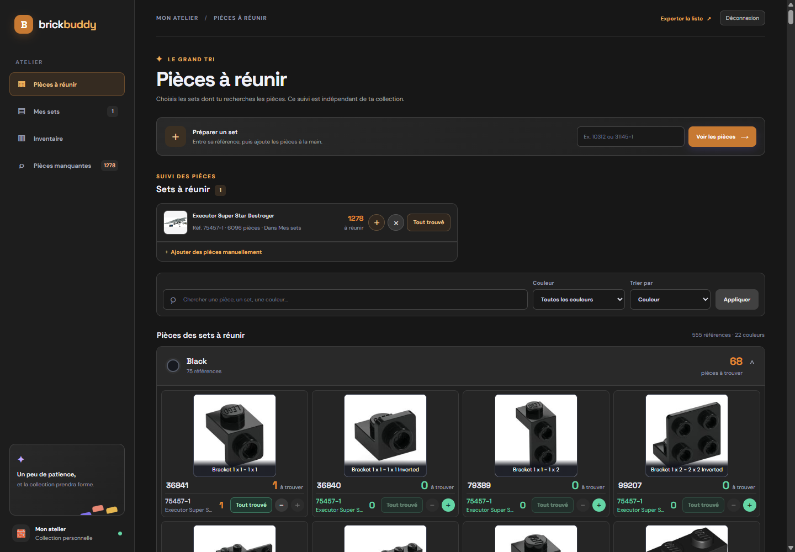
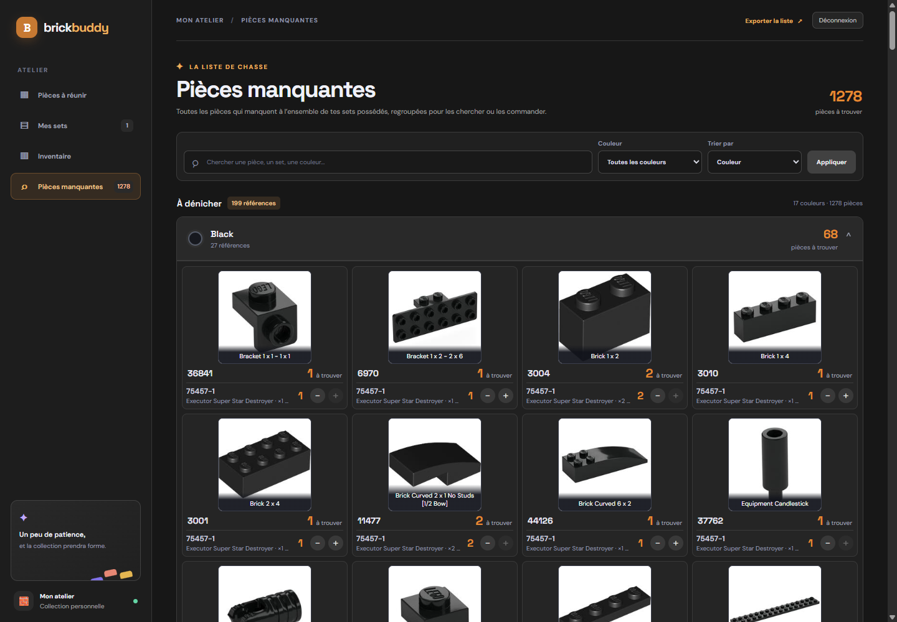

<div align="center">

<h1 align="center"></h1>

### Ta collection LEGO, claire, complète et toujours à portée de main.

**Suis tes sets. Repère chaque pièce manquante. Garde ton inventaire sous contrôle.**

[](https://www.python.org/)
[](https://flask.palletsprojects.com/)
[](https://www.sqlite.org/)
[](https://www.docker.com/)
[](https://github.com/Gazz-yniere/BrickBuddy/actions/workflows/tests.yml)

<br>

<a href="docs/screenshots/mes-sets.png"></a>

<sub>Vraies images du set 75457-1 et de ses pièces · suivi de démonstration</sub>

<br>

[Découvrir l’atelier](#un-atelier-pour-chaque-brique) ·
[Installer en local](#lancer-en-local) ·
[Utiliser l’image Docker](#lancer-avec-limage-docker) ·
[Site et démo](https://gazz-yniere.github.io/BrickBuddy/)

</div>

## Un atelier pour chaque brique

Brick Buddy est une application web en français pour organiser une collection LEGO et retrouver ce qu'il reste à construire ou à compléter. Chaque écran a son rôle.

| Écran | Ce qu'il permet |
|---|---|
| **Accueil** | Une carte par écran (sets, pièces à réunir, inventaire, manquantes, notices, valeur estimée) avec ses compteurs. |
| **Pièces à réunir** | Préparer plusieurs sets et regrouper les besoins par pièce et par couleur. |
| **Mes sets** | Suivre les sets possédés et l'état de chaque exemplaire, pièce par pièce. |
| **Inventaire** | Retrouver les pièces réellement disponibles, dans les sets possédés et le vrac. |
| **Pièces manquantes** | Voir ce qui reste à trouver, ajuster les quantités, exporter la liste. |
| **Construire** | Chercher les notices LEGO d'un set, les télécharger, les lire sur place. |
| **Paramètres** | Enregistrer les clés, activer les prix, relancer le relevé du taux et des prix. |

### Ce qui compte en pratique

- **Posséder un set et rechercher ses pièces sont deux suivis indépendants.**
- **Chaque exemplaire garde son propre état** : une copie complète et une copie incomplète se distinguent.
- **Une couleur, une carte** : les pièces d'une même couleur sont groupées même si le nom a été écrit différemment (« Rouge » et « Red »). Le nom affiché est le nom officiel, en anglais ; les nuances proches restent distinctes (« Blue », « Dark Blue »).
- **Les figurines se vérifient pièce par pièce** : une figurine complète marque ses composants comme trouvés.
- **Les listes s'exportent** en XML BrickLink ou CSV BrickOwl, depuis « Pièces manquantes ».
- **Les prix sont optionnels** : prix unitaire, total par pièce, valeur estimée de l'inventaire, relevés chaque jour chez BrickOwl.
- **La navigation ne recharge jamais la page** : filtres, compteurs, ajouts et suppressions remplacent la zone de résultats.
- **Un mot de passe partagé, une protection CSRF, une limitation des tentatives.** Données locales en SQLite.

## Utiliser Brick Buddy

1. **« Accueil »** résume la collection et chaque carte mène à son écran.
2. **« Pièces à réunir »** : entre la référence d'un set. Avec une clé Rebrickable, son inventaire et les compositions des figurines sont importés.
3. Les boutons `−`, `+` et la coche règlent les pièces à trouver ; une référence commune à plusieurs sets présente une ligne par set.
4. **« Pièces de cette figurine »** se déplie pour suivre les composants, quantité par quantité.
5. **Le vrac** se gère dans « Inventaire » ; « Prendre dans le vrac » transfère les quantités disponibles vers les sets en recherche. « Vérifier un set » compare ses besoins au vrac et aux sets (nécessite une clé Rebrickable).
6. **« Mes sets »** : « J'ai ce set » pour le posséder, « Rechercher » / « Pause » pour le faire apparaître ou non dans « Pièces à réunir », « Tout trouvé » / « Tout chercher » pour tout le set.
7. **« Pièces manquantes »** est le seul écran avec le bouton d'export.
8. **« Paramètres »**, en bas du menu : clés, prix, relevé du taux.

Sans clé Rebrickable : ajoute le set dans « Mes sets », déplie-le et saisit ses pièces à la main, puis « Suivre » pour les retrouver dans « Pièces à réunir ».

## Les notices

- **« Construire »** recherche les notices officielles LEGO et accepte tes propres PDF (zone de dépôt ou bouton « Ajouter »).
- Les fichiers enregistrés sont **partagés par la référence** : les exemplaires d'un même set lisent la même notice, et un retrait touche tous les exemplaires.
- Un carrousel liste les livres, les flèches ← → les parcourent, le lecteur affiche le PDF sur place. Les notices LEGO distantes ne peuvent pas être affichées dans un encadré : seuls les PDF locaux sont lus.
- Un fichier est limité à **200 Mo** et rangé dans `data/instructions/` : sauvegarde ce dossier avec la base.

## Configuration

Crée le fichier local `.env` à partir du modèle, et génère une clé de session :

```powershell
Copy-Item .env.example .env
py -c "import secrets; print(secrets.token_urlsafe(48))"
```

Renseigne au minimum :

```dotenv
SECRET_KEY=colle-ici-la-cle-aleatoire-generee
APP_PASSWORD=choisis-une-phrase-secrete-de-12-caracteres-minimum
```

`SECRET_KEY` : au moins 32 caractères. `APP_PASSWORD` : au moins 12 caractères. `.env` n'est jamais commité.

| Variable | Rôle |
|---|---|
| `SECRET_KEY` | Signe les sessions. |
| `APP_PASSWORD` | Mot de passe partagé. |
| `REBRICKABLE_API_KEY` | Import des sets et pièces. Facultative. |
| `BRICKOWL_API_KEY` | Nécessaire aux prix (ils n'existent pas chez Rebrickable). |
| `SHOW_PRICES` | `true` pour afficher les prix. |
| `PRICE_GBP_EUR_RATE` | Repli du taux livres → euros ; `1.18`. |
| `DATABASE_PATH` | Base SQLite ; `data/legolist.db` par défaut. Le cache d'images, les notices et `bdd.bak` se placent à côté. |
| `PORT` | Port local ; `8000`. |
| `SESSION_COOKIE_SECURE` | `true` seulement en HTTPS. |
| `DOCKERHUB_USERNAME`, `DOCKERHUB_REPOSITORY`, `IMAGE_TAG` | Image Docker ; `brickbuddy`, `latest`. |

- Une valeur enregistrée dans **« Paramètres »** passe devant le `.env` ; une clé enregistrée n'est jamais affichée ni écrite dans le journal, un champ vide la supprime.
- Une clé BrickOwl gratuite se crée sur [brickowl.com](https://www.brickowl.com/seller/api). Les prix sont **indicatifs** : ce sont des moyennes d'offres actuelles.
- Le taux livres → euros est relevé chaque jour chez [open.er-api.com](https://open.er-api.com/) (service public, sans clé) ; le bouton « Rafraîchir les prix » relance la relève sans attendre le lendemain.

## Ce que l'application appelle dehors

| Service | Ce qu'il apporte | Clé |
|---|---|---|
| **Rebrickable** (`rebrickable.com/api/v3`) | Inventaire d'un set, thème, figurines, images | Oui |
| **BrickOwl** (`api.brickowl.com`) | Prix des pièces, références « BOID » | Oui |
| **open.er-api.com** | Taux livres → euros | Non |
| **LEGO** (`lego.com/cdn/product-assets`) | Notices et couvertures | Non |
| **Google Fonts** | Polices de l'interface | Non |

Les appels à Rebrickable sont cadencés et ne passent jamais dans le journal. Sans connexion, les sets importés, les prix relevés et les notices téléchargées restent disponibles.

## Où vivent les données

| Emplacement | Contenu |
|---|---|
| `data/legolist.db` | La base : sets, pièces, vrac, figurines, notices, réglages, clés, prix, taux |
| `data/images/` | Cache des images Rebrickable |
| `data/instructions/` | Les PDF de notices |
| `data/bdd.bak` | Copie de la base faite avant une mise à jour |
| `.env` | Les secrets locaux, ignoré par Git |

`data/` est personnel : jamais publié, et conservé par le volume Docker. Une page est limitée à **5 Mo**.

## Lancer en local

```powershell
py -m venv .venv
.\.venv\Scripts\Activate.ps1
pip install -r requirements.txt
py app.py
```

Puis [http://localhost:8000](http://localhost:8000), connecté avec le mot de passe du `.env`. La base se crée toute seule dans `data\legolist.db`.

## Lancer avec l'image Docker

Renseigne l'identifiant Docker Hub dans `.env`, puis :

```dotenv
DOCKERHUB_USERNAME=ton-identifiant-dockerhub
DOCKERHUB_REPOSITORY=brickbuddy
IMAGE_TAG=latest
```

```powershell
docker compose pull
docker compose up -d --no-build
```

### Mettre à jour sans perdre la base

Le service `backup` lit la même base que l'application (`./data:/data`). Sauvegarde d'abord, remplace le conteneur ensuite :

```powershell
docker compose run --rm backup
docker compose up -d --pull always --build brickbuddy
```

La première commande écrit `data/bdd.bak`, à côté de la base, et survit au remplacement du conteneur. Pour revenir en arrière :

```powershell
docker compose down
Copy-Item data\bdd.bak data\legolist.db
docker compose up -d
```

Hors Docker : `python -m brickbuddy.backup`. Pour arrêter sans supprimer les données : `docker compose down`. `http://localhost:8000/health` indique si l'application et sa base répondent.

## Données et sauvegardes

- Copier `data/` vers un emplacement sûr sauvegarde la collection, y compris les clés enregistrées dans la base.
- Un mot de passe partagé : pas de comptes individuels ni de collections séparées.
- Exposée sur Internet, l'application doit être derrière HTTPS avec `SESSION_COOKIE_SECURE=true`.

## Comment le code est organisé

| Dossier | Rôle |
|---|---|
| `app.py` | Façade : modules, routes, serveur (`python app.py`, `gunicorn app:app`) |
| `brickbuddy/` | Le code, un module par sujet (`db`, `colors`, `prices`, `rates`, `instructions`, `backup`…), `routes/` par écran |
| `templates/` | Les pages Jinja, en français |
| `static/css/` | Quinze feuilles par rôle, dont les variables et la feuille critique |
| `static/js/` | Quatre modules, sans cadre JavaScript |
| `tests/` | Les tests, avec un socle commun |
| `docs/` | Le site GitHub Pages et sa démo hors ligne |

Les tests se lancent avec `python -m pytest -q` sur Python 3.12 ; les vérifications d'un changement sont dans [CONTRIBUTING.md](CONTRIBUTING.md).

## Présentation et démo

Le [site GitHub Pages](https://gazz-yniere.github.io/BrickBuddy/) présente le projet et une démo interactive, publiée depuis [`docs/`](docs/) par GitHub Actions (active **Settings → Pages → Build and deployment → GitHub Actions**). La démo suit le set réel 75193-1 (89 pièces et une figurine, soit 90 éléments suivis contre 92 annoncés sur la boîte) et un vrac fictif ; ses images viennent de Rebrickable. Elle est statique : elle ne se connecte ni à ta base ni à Rebrickable. Pour une vraie collection, lance l'application en local ou avec Docker.

## L'atelier en images

Captures du set réel **[75457-1 · Executor Super Star Destroyer](https://rebrickable.com/sets/75457-1/)**, dans une base de démonstration isolée ; les quantités sont simulées.

<table>
<tr>
<td width="50%" valign="top">
<a href="docs/screenshots/pieces-a-reunir.png"></a>
<p align="center"><strong>Pièces à réunir</strong><br><sub>Besoins par couleur et référence.</sub></p>
</td>
<td width="50%" valign="top">
<a href="docs/screenshots/mes-sets.png"></a>
<p align="center"><strong>Mes sets</strong><br><sub>Fiche dépliée, images réelles des pièces.</sub></p>
</td>
</tr>
<tr>
<td width="50%" valign="top">
<a href="docs/screenshots/inventaire.png"></a>
<p align="center"><strong>Inventaire</strong><br><sub>Pièces disponibles, par couleur.</sub></p>
</td>
<td width="50%" valign="top">
<a href="docs/screenshots/pieces-manquantes.png"></a>
<p align="center"><strong>Pièces manquantes</strong><br><sub>Quantités à retrouver.</sub></p>
</td>
</tr>
</table>

> Brick Buddy est un projet de collection non officiel, sans affiliation ni approbation de LEGO® ou du groupe LEGO.

## Les limites du projet

- Une seule personne accède à l'application.
- Les prix sont indicatifs, jamais garantis.
- Les notices LEGO distantes ne s'affichent pas dans un encadré : seuls les PDF locaux sont lus.
- La démo GitHub Pages est statique.

Pour contribuer, vois le [guide de contribution](CONTRIBUTING.md). Les évolutions sont dans le [changelog](CHANGELOG.md), le code est sous [licence MIT](LICENSE) ; les images et données Rebrickable et les marques citées restent soumises aux droits de leurs détenteurs.
